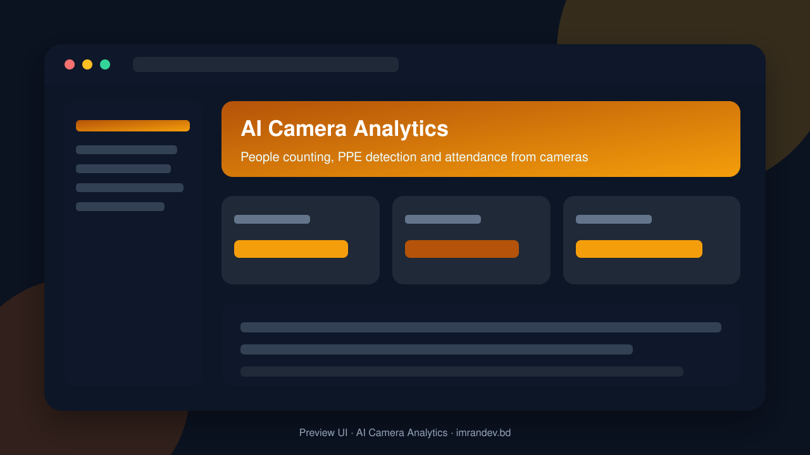
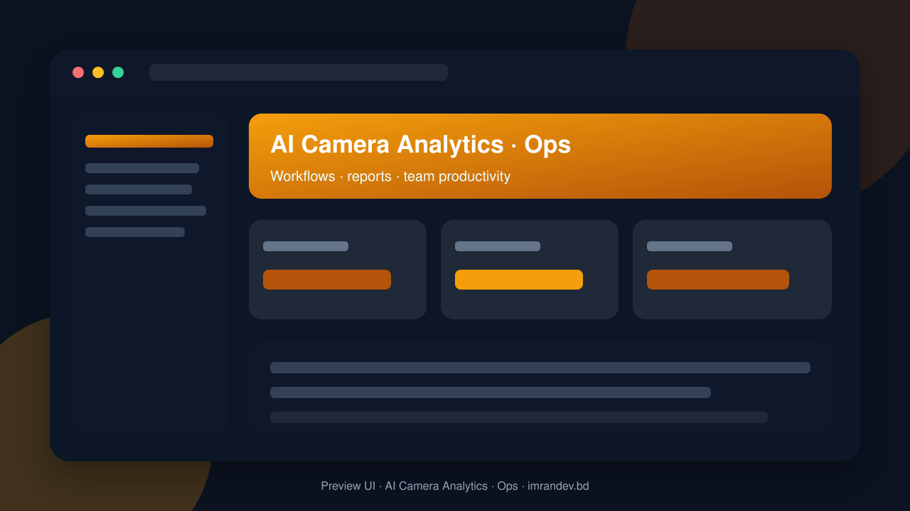

<p align="center">
  
</p>

<h1 align="center">AI Camera Analytics</h1>

<p align="center"><strong>People counting, PPE detection and attendance from cameras</strong></p>

<p align="center">
  <a href="https://github.com/imranbru99/ai-camera-analytics-people-counting"></a>
  
  
</p>

---

## Overview

**AI Camera Analytics** is a complete business application focused on real operational workflows. This README lists the full feature surface so GitHub visitors and search engines can understand every capability of the product.

## Product preview

| Dashboard | Operations |
| :---: | :---: |
|  |  |

## Complete feature list

### Product modules & capabilities

- AI CAMERA ANALYTICS
- Senior Laravel Engineer
- AI and Computer Vision Engineer
- Python Backend Engineer
- Cybersecurity Engineer
- DevOps Engineer
- QA and Automation Engineer
- Technical Documentation Engineer
- Warehouses
- Safety helmet detection
- Safety vest detection
- Employee attendance
- Entry and exit analytics
- Peak-hour analytics
- Safety equipment detection
- Shift attendance
- Redis
- Laravel Queue + Redis
- Camera and hardware product catalog
- Supplier product information
- AI-assisted catalog management
- Report summarization
- Natural-language analytics
- Management insights
- Automated report narratives
- OpenRouter
- Attendance device connections
- Attendance event synchronization
- Device management
- Employee attendance logs
- Virtual attendance integrations
- Attendance reports
- Safety reports
- Camera reports
- Invoices
- Incident reports
- Employee reports
- Analytics reports
- Exported management documents
- Module dependency manager
- Active cameras
- Total attendance events
- Safety alerts
- System health
- Edit organization
- User management
- Site management
- Camera assignments
- Add camera
- Edit camera
- Delete camera
- Camera categories
- Camera model
- Camera credentials
- Camera status
- Camera health
- Camera location
- Camera grouping
- Camera tags
- Camera maintenance history

### Domain models

- A I Engine
- Analytics Report
- Attendance
- Camera
- People Counting
- Saa S Business Engine
- Safety Incident
- Safety Incident Report

### HTTP / API controllers

- A I APIs & screens
- Attendance APIs & screens
- Camera APIs & screens
- Demo APIs & screens
- Saa S Business APIs & screens
- Safety Incident APIs & screens
- Safety Incident Report APIs & screens

### Detailed feature requirements delivered

- Product: AI Camera Analytics
- Tagline: Intelligent Video Analytics, Workplace Safety & Smart Attendance
- Category: AI SaaS / Computer Vision / IoT / Workforce Management
- Architecture: Modular Multi-Tenant SaaS
- Backend: PHP Laravel 12
- Admin: Filament 5
- Database: MySQL 8+
- AI Engine: Python FastAPI + OpenCV + ONNX Runtime
- Queue: Redis
- Frontend: Blade + Livewire + Tailwind CSS
- Deployment: Docker-ready, cloud and on-premise capable
- PRODUCT VISION
- TECHNICAL ARCHITECTURE
- REQUIRED COMPOSER PACKAGES
- COMPLETE MODULAR SYSTEM
- Organization: ABC Garments Ltd.
- COMPLETE MODULE LIST
- Camera: Production Floor 01
- People detected: 35
- Helmet compliant: 30
- Vest compliant: 32
- Missing helmet: 5
- Missing vest: 3
- Status: Review required
- Site: Factory A
- Camera: Production Floor 02
- Zone: Cutting Section
- Event: Possible missing safety helmet
- Time: 10:35 AM
- Action: Review the detection.
- MULTI-TENANT ARCHITECTURE
- USER TYPES AND PERMISSIONS
- VIDEO PROCESSING ARCHITECTURE
- DATABASE DESIGN
- FILAMENT DASHBOARD DESIGN
- PUBLIC WEBSITE
- DEMO ENVIRONMENT
- MULTILINGUAL SUPPORT
- SECURITY AND PRIVACY
- NOTIFICATION AND AUTOMATION ENGINE
- PERFORMANCE AND SCALABILITY
- API AND WEBHOOK DOCUMENTATION
- README.MD — COMPLETE DOCUMENTATION
- Section 1: Introduction
- Section 2: Complete feature list
- Section 3: Screenshots
- Section 4: Technology stack
- Section 5: Architecture
- Section 6: Installation
- Section 7: Configuration
- Section 8: Demo accounts
- Section 9: Modules
- Section 10: AI integration
- Section 11: Camera integration
- Section 12: Attendance integration
- Section 13: API documentation
- Section 14: Security
- Section 15: Deployment
- Section 16: Troubleshooting
- Section 17: Testing
- Section 18: Roadmap
- INSTALLATION AND DEPLOYMENT
- TESTING REQUIREMENTS
- FINAL ACCEPTANCE CRITERIA
- IMPORTANT DEVELOPMENT RULES
- FINAL INSTRUCTION TO THE AI CODING AGENT

### Platform capabilities

- Multi-role ready structure for operators, managers and admins
- Database migrations and seeders for demo-ready local setup
- Laravel architecture with services/controllers/models separation
- Responsive UI foundation (Blade / Filament where enabled)
- Environment-based config for local and production databases
- GitHub-ready documentation with visual product previews

## Tech stack

- PHP 8.2+ / Laravel
- Filament admin resources (where enabled)
- Vite asset pipeline
- SQLite/MySQL-ready database layer
- Migrations, seeders, and test-ready structure

## Quick start

```bash
git clone https://github.com/imranbru99/ai-camera-analytics-people-counting.git
cd ai-camera-analytics-people-counting
composer install
cp .env.example .env
php artisan key:generate
php artisan migrate --seed
npm install && npm run build
php artisan serve
```

## Repository

- GitHub: https://github.com/imranbru99/ai-camera-analytics-people-counting
- Developer: **Imran Ahmed** · https://imrandev.bd

---

## 🤝 Let's Connect & Collaborate

I am open to **Senior Remote Full-Stack Roles**, AI Platform Architecture Contracts, and Enterprise Technical Advisory.

**Timezone:** UTC+6 (Dhaka / Rangpur, Bangladesh) — flexible overlap with US, UK & EU hours.  
**Delivery:** Async-ready · Slack · Discord · Jira · GitHub · production-first accountability.

| Channel | Handle | Link |
| :--- | :--- | :--- |
| Portfolio | imrandev.bd | https://imrandev.bd |
| Packagist | imrandevbd | https://packagist.org/packages/imrandevbd/ |
| LinkedIn | imranbru99 | https://linkedin.com/in/imranbru99 |
| GitHub | imranbru99 | https://github.com/imranbru99 |
| WhatsApp | +880 1576-918420 | https://wa.me/8801576918420 |
| Email | me@imrandev.bd | mailto:me@imrandev.bd |
| X | @imrandev_bd | https://x.com/imrandev_bd |
| YouTube | @ImranDevBD | https://youtube.com/@ImranDevBD |
